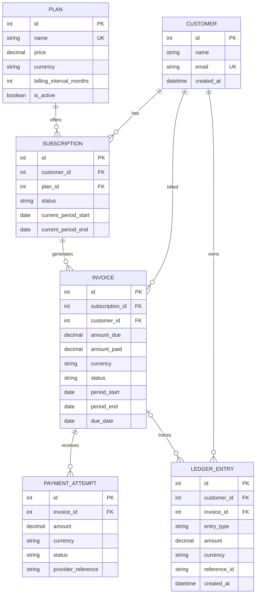

# SubLedger

SubLedger is a small subscription billing backend that demonstrates a layered FastAPI and SQLAlchemy design. It handles plans, customers, subscriptions, invoice generation, payment attempts, and an append-only ledger. It is an educational foundation, not a payment processor.

## Run locally

Requires Python 3.11+.

```powershell
py -m venv .venv
.\.venv\Scripts\Activate.ps1
python -m pip install -r requirements.txt
uvicorn app.main:app --reload
```

The default database is SQLite at `./subledger.db`. Set `DATABASE_URL` to change it, for example `sqlite:///./local.db` or a SQLAlchemy-supported PostgreSQL URL. Tables are created at application startup. OpenAPI / Swagger UI is available at `http://127.0.0.1:8000/docs`; health check is `/health`.

Run tests with `pytest`. To run the service in Docker, use `docker compose up --build`; the SQLite database persists in the named `subledger-data` volume.

## API

All business endpoints are under `/api/v1`.

| Method | Endpoint | Purpose |
|---|---|---|
| POST / GET | `/customers` | Create / list customers |
| POST / GET | `/plans` | Create / list plans |
| POST | `/plans/{plan_id}/deactivate` | Deactivate a plan |
| POST / GET | `/subscriptions` | Create / list subscriptions |
| POST | `/subscriptions/{subscription_id}/cancel` | Cancel an active subscription |
| POST / GET | `/invoices` | Generate / list invoices |
| POST / GET | `/invoices/{invoice_id}/payments` | Record / list payment attempts |
| GET | `/ledger?customer_id={id}` | List ledger entries, optionally filtered by customer |

Payment status accepts `succeeded` or `failed`. Invoice generation accepts an optional period, requiring both `period_start` and `period_end` when specified. The generated invoice response captures the plan price and currency as of generation time.

## Design (LLD)

### Architectural layers

HTTP routes validate/transport requests and responses; services implement use cases and business rules; repositories isolate SQLAlchemy persistence; models represent relational entities; Pydantic schemas define API contracts; configuration and `db.py` centralize settings, engine/session management, and table initialization.

| Layer | Responsibility | Examples |
|---|---|---|
| Routes | HTTP endpoints, status/response shape, dependency injection | `app/routes/catalog.py`, `app/routes/billing.py` |
| Services | Workflow orchestration, validation, atomic transaction boundary | `CatalogService`, `InvoiceService`, `PaymentService`, `LedgerService` |
| Repositories | Persistence queries and writes | Catalog and billing repositories |
| Models | Relational schema and associations | Customer, Plan, Subscription, Invoice, PaymentAttempt, LedgerEntry |
| Schemas | Input validation and output serialization | `app/schemas.py` |
| Configuration / DB | Environment settings, engine, sessions, table setup | `app/config.py`, `app/db.py` |

### ERD



### Service and repository responsibilities

| Component | Responsibility |
|---|---|
| `CatalogService` | Customer uniqueness, plan creation/deactivation, subscription eligibility, duplicate active plan checks, billing period initialization/cancellation |
| `InvoiceService` | Validate active subscription, select period, prevent duplicate invoices, snapshot current plan price/currency, create invoice and ledger event in one transaction |
| `PaymentService` | Validate invoice/currency/remaining balance, persist every attempt, update invoice only on success, append outcome ledger event in one transaction |
| `LedgerService` | Append traceable billing events; there are deliberately no update/delete operations |
| `CustomerRepository` | Customer lookup, email lookup, creation, listing |
| `PlanRepository` | Plan lookup, creation, listing |
| `SubscriptionRepository` | Subscription lookup, active customer-plan lookup, create/cancel/list |
| `InvoiceRepository` | Invoice lookup, period duplicate check, create/list |
| `PaymentAttemptRepository` | Attempt creation and invoice-specific listing |
| `LedgerRepository` | Ledger insertion and chronological listing |

### Business-rule ownership

| Rule | Owner / enforcement |
|---|---|
| Plan price is positive | Pydantic `PlanCreate` validation and database check constraint |
| Customer email is unique | `CatalogService` normalized lookup plus database unique constraint |
| Inactive plans cannot be subscribed to | `CatalogService.create_subscription()` |
| No two active subscriptions to the same plan for a customer | `CatalogService.create_subscription()` |
| Invoice price is the plan price at invoice creation | `InvoiceService` copies `Plan.price` and currency to invoice |
| Successful payment cannot exceed remaining balance | `PaymentService.record_payment()` and invoice database amount check |
| Full/partial payments update invoice state | `PaymentService.record_payment()` |
| Failed attempts do not increase paid amount | `PaymentService.record_payment()` |
| Ledger entries are append-only and traceable | Insert-only repository/service API; `reference_id` is indexed for traceability |
| One invoice per subscription billing period | Invoice unique constraint and duplicate check in `InvoiceService` |

### Core flows

**Invoice generation:** route validates input → `InvoiceService` loads active subscription and plan → computes/defaults billing period and snapshots amount/currency → repository inserts invoice → `LedgerService` appends `invoice_created` → one database commit → response.

**Payment recording:** route validates payment payload → `PaymentService` loads invoice and validates currency and amount → repository inserts attempt → success updates amount paid and status, failure leaves invoice balance/status untouched → `LedgerService` appends success/failure event using provider reference → one database commit → attempt and invoice response.

### Design patterns and transaction behavior

The code uses a layered architecture with dependency injection through FastAPI's database-session dependency, repository classes as persistence boundaries, and application services as use-case coordinators. Services share one request-scoped SQLAlchemy session and commit the invoice/payment plus corresponding ledger event together, so those records cannot be committed independently through the normal API flow.

## Assumptions and limitations

- Billing intervals are whole months (1–12); the monthly date helper clamps to the last valid day of the destination month.
- The initial invoice period defaults to the subscription's current period; invoice due date defaults to 30 days after period start.
- Currency is a three-letter uppercase code. Payment processing is simulated: no gateway calls, refunds, retries, proration, tax, discounts, or real settlement are implemented.
- The ledger is append-only through the application API; database administrators can still alter rows directly. Production-grade tamper evidence would require database permissions/triggers and/or an external immutable audit store.
- Table creation uses `create_all` for a small assignment. Production deployments should use Alembic migrations, stronger authentication/authorization, concurrency-safe subscription/payment idempotency, structured logging, and a production database.
- Concurrent requests may race around application-level subscription validation; production should enforce the relevant active-subscription invariant with database constraints or locking.
